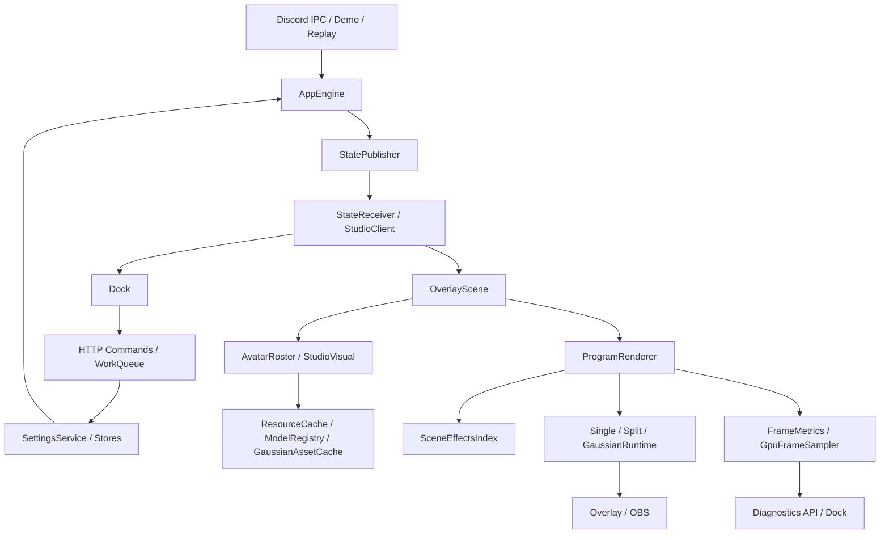

# ENTAKU 改修の引き継ぎ

記録日：2026-11-27（日本時間）

## 1. 再開地点

| 項目 | 値 |
|---|---|
| リポジトリ | [Discord-ENTAKU-Overlay](https://github.com/zkamiyama/Discord-ENTAKU-Overlay) |
| 作業ブランチ | `fix/entaku-stability-performance-audit` |
| PR | [#6（Draft）](https://github.com/zkamiyama/Discord-ENTAKU-Overlay/pull/6) |
| この記録の実装対象 | [`a160eac6133fb85a1386ab77565ad15450f7dc8e`](https://github.com/zkamiyama/Discord-ENTAKU-Overlay/commit/a160eac6133fb85a1386ab77565ad15450f7dc8e) |
| 改修前の main | [`33a6ac171e78b32a1f6a5e336026a0e10b2c678c`](https://github.com/zkamiyama/Discord-ENTAKU-Overlay/commit/33a6ac171e78b32a1f6a5e336026a0e10b2c678c) |
| 最新実装のCI | [46016079185](https://github.com/zkamiyama/Discord-ENTAKU-Overlay/actions/runs/46016079185) |
| バージョン | 0.1.0-rc.15、ブラウザ通信プロトコル v2 |

実装は8コミット、改修前のmainとの差分は59ファイル。今回の文書更新はこの実装を記録するもので、ソースやテストは変更しない。PRは未マージ。ブラウザCIで4件の失敗が確認されたため、配布可能な完成版とは扱わない。

利用者の依頼は、最新の実装を高速かつ障害に強い構造にすること。不要なコードや旧通信の互換層は廃止してよく、有用な既存ライブラリも利用できる。実装上の判断は作業者が行い、機能や利用者データの扱いに関わる選択で判断が不可欠な場合だけ利用者に確認する。画質や安全性を下げて速度を上げたことにはしない。

## 2. 検証結果と未解決事項

### CIで確認したこと

実装対象の[CI 46016079185](https://github.com/zkamiyama/Discord-ENTAKU-Overlay/actions/runs/46016079185)のジョブ結果。確認後にCIの状態が変わることがあるため、再開時は対象SHAと最新結果を照合する。

| ジョブ | 記録時の結果 |
|---|---|
| browser (1) | 36件成功、3件失敗。22.3分 |
| browser (2) | 36件成功、1件失敗。10.1分 |
| Linux check | 実行中。依存インストール成功、`bun run check` の終了結果未確認 |
| Windows check | 実行中。依存インストール成功、`bun run check` の終了結果未確認 |

両ブラウザジョブでWeb素材のビルドは成功した。ブラウザ試験は合計72件成功、4件失敗。テストの上限やタイムアウトを緩めていない。

改修前mainの[CI 42794469408](https://github.com/zkamiyama/Discord-ENTAKU-Overlay/actions/runs/42794469408)では、Gaussian native素材の反復試験でtexture数が上限73に対し81となり、発話グロー2件もタイムアウトした。最新CIではリソース試験は失敗一覧にない。一度の通過を、長時間のGPUメモリ増加が解消した証拠とはしない。

前段階の`d2cd696`ではLinux・Windowsの型検査、単体・結合、実行ファイルビルド、起動確認、Windows配布ZIP検証が成功した。後続のコミットによってブラウザジョブが途中でキャンセルされたため、最新実装の合格を示す記録ではない。

### P0：先に直すブラウザ試験

| 試験・再現箇所 | ログで確認した症状 | 次に調べる箇所 |
|---|---|---|
| [camera-refinement.spec.ts:8](../e2e/camera-refinement.spec.ts) | `data-studio-status=READY` と near=0.15 の確認後、`data-camera-local-position` がnull | `OverlayScene.prepare` は初回状態の受信前もREADYを返す。初回描画の準備完了条件と属性の公開順を確認する |
| [studio-assets.spec.ts:58](../e2e/studio-assets.spec.ts) | 発話停止後15秒以内に `data-mesh-speaking` が1から0にならない | `OverlayScene.prepare` と `Avatar.render` の発話強度、raw STOP、`dt` 上限、`MeshSpeechGlow.active` の判定を比較する |
| [gaussian-speech-glow.spec.ts:12](../e2e/gaussian-speech-glow.spec.ts) | 240秒でタイムアウト | `mode=2, glowScale=4` は13フレームに61,466ms。scale=8の処理開始後に完了ログがない |
| [gaussian-speech-glow.spec.ts:36](../e2e/gaussian-speech-glow.spec.ts) | 300秒でタイムアウト | 重なる2体で発話者を変えた処理は60,759ms、64,060ms。分割の4条件は完了し、MSAA・SSR・AO・DoF・Bloomの複合条件に入った後に完了ログがない |

最初の2件は今回の改修後に発生した失敗で、原因はまだ確定していない。特にGLBは発話停止と見た目のフェードを別々に観測し、ソフトウェア描画のフレーム間隔が長い場合にも意図した停止時間になるか確認する。

Gaussianの2件は従来からの失敗。上表の時間はSwiftShader上の試験工程にかかった時間であり、実GPUの1フレーム時間ではない。LoD収束、シェーダー生成、GPU描画、画素読み戻しを区別して計測する。発話の見た目、遮蔽、人物ごとの独立性に関する合格条件を維持する。

### 証拠の取得

- [browser (1) のログ](https://github.com/zkamiyama/Discord-ENTAKU-Overlay/actions/runs/46016079185/job/140563582522)・[証拠ZIP](https://github.com/zkamiyama/Discord-ENTAKU-Overlay/actions/runs/46016079185/artifacts/15208121409)
- [browser (2) のログ](https://github.com/zkamiyama/Discord-ENTAKU-Overlay/actions/runs/46016079185/job/140563582142)・[証拠ZIP](https://github.com/zkamiyama/Discord-ENTAKU-Overlay/actions/runs/46016079185/artifacts/15206666680)

証拠ZIPの保存期間は14日。ダウンロードして `test-results/**/trace.zip` と `.work/gaussian/` を確認する。ログには `ENTAKU_SPEECH_SETTLE_START`、`PROGRESS`、`END` がある。反復試験では `resource-lifetimes-proxy.json` と `resource-lifetimes-native.json` にサイクルごとの測定を残す。以前の単一ファイル名 `resource-lifetimes.json` は歴史的な記録である。

今回はログの確認まで実施した。証拠ZIPの内容と画素画像を個別に検査していない。

## 3. 現在の構造

設計判断の詳細は [ADR 0026](adr/0026-state-stream-and-resource-ownership.md)、色・透過・深度の処理順は [描画パイプライン](render-pipeline.md) を参照する。



### モジュールごとの担当

| モジュール | 主な担当・更新条件 |
|---|---|
| [domain/engine.ts](../src/domain/engine.ts) | 参加者、座席、設定、カメラ演出の状態。HTTPの単純な照会には軽量な読み取りメソッドを使用する |
| [studio/change-keys.ts](../src/studio/change-keys.ts) | GLB・スタジオの再構築条件とカメラ安全条件を分離。LoDや露出などの描画設定だけでは再構築しない |
| [contracts/state-stream.ts](../src/contracts/state-stream.ts) | 全量・差分パケットの生成と復元、世代・連番の照合 |
| [server/work-queue.ts](../src/server/work-queue.ts)・[bounded-body.ts](../src/server/bounded-body.ts) | 変更操作は実行中を含め8件まで。コマンドは256KiBまで。終了時に待機操作を中止し実行中の操作を待つ |
| [web/overlay/scene.ts](../src/web/overlay/scene.ts)・[roster.ts](../src/web/overlay/roster.ts) | 状態受信とフレームの準備を分離。座席がある参加者に描画資源を割り当て、退出フェード後に解放する |
| [web/shared/resource-cache.ts](../src/web/shared/resource-cache.ts)・[studio/model-registry.ts](../src/web/studio/model-registry.ts) | GLB・Gaussianで共通の参照管理を使う。読み込み中にも参照を保持し、最後の解放で素材を破棄する |
| [web/studio/visual.ts](../src/web/studio/visual.ts) | 候補シーンの完成後に表示を切り替える。失敗した候補を解放し、既存シーンを残す |
| [web/overlay/program-renderer.ts](../src/web/overlay/program-renderer.ts) | Single／Splitの選択、露出、影・反射インデックスとLoD予算 |
| [web/studio/scene-effects-index.ts](../src/web/studio/scene-effects-index.ts) | 全ビューに共通する影・反射対象。不要な影のターゲットを解放する |
| [web/gaussian/runtime.ts](../src/web/gaussian/runtime.ts) | カメラ別のSparkビュー、選択・ソート。追加は既存ビューを維持し、削除は古い表示を防ぐためビューを破棄する |
| [web/overlay/frame-metrics.ts](../src/web/overlay/frame-metrics.ts)・[server/render-report.ts](../src/server/render-report.ts) | フレーム・CPU・GPU時間の標本と診断報告の検査 |

### 通信プロトコル v2

`/ws` は初回と再同期に全量の `snapshot` を送り、通常の更新では `snapshot-delta` を送る。全量には `frame` と `state`、差分には `epoch`、`base`、`frame`、`changes`、`removed` が含まれる。差分はトップレベルの項目単位であり、任意のJSONパスを変更する方式ではない。

`serverEpoch` は再起動・リプレイの世代、`revision` は設定操作の競合検査、`seq` はドメイン内の更新、`frame` は通信の連番を示す。同じ値として扱わない。受信側は連番や世代の不一致を拒否して `resync` を要求する。変更されない状態の参照は維持され、受信状態は凍結される。

旧v1クライアントとの互換層はない。exeを更新した際はDockとOverlayの両方を再読み込みする。保存済みの設定・素材は今回のために削除しない。VC-CHATは引き続き別購読で、映像・プリセット・発話記録・診断に本文を混ぜない。

### GPU資源の所有者

| 資源 | 所有者と解放の条件 |
|---|---|
| GLBジオメトリ・テクスチャ・画像 | `StudioModelRegistry` のソース。最後の参照を解放したときに破棄 |
| GLBのノード・個別マテリアル・骨格・インスタンス配列 | 各配置。候補失敗、配置削除、シーン交換で破棄 |
| Gaussian PackedSplats・proxyの元データ | `GaussianAssetCache`。最後の参照を解放したときに破棄 |
| Gaussian人物とproxyの配置 | `GaussianAvatarVisual`。共有データを破棄せず、先に描画側の参照を解除 |
| ソート、LoD選択、ビューのGPUターゲット | `GaussianRuntime` とカメラ別のSparkRenderer |
| 影・露出・SSR・AO・合成ターゲット | `ProgramRenderer` 以下の該当パス。世界座標の索引は共用し、ビューの深度と描画先は別 |
| エディタのプレビュー | 開いているエディタ。閉じる際に独立したRendererを破棄 |

Three.js 0.187.0、Spark 2.4.0、fflate 0.8.3、Bun 1.4.4を維持。GLBの複製には公式の `SkeletonUtils.clone` を使用し、GTAOPassやSSRの破棄処理は `addon-adapters.ts` で補う。追加のランタイム依存はない。

## 4. コミットの順序

| コミット | 変更 |
|---|---|
| [24c7282](https://github.com/zkamiyama/Discord-ENTAKU-Overlay/commit/24c7282f4ccfd656efadfd62ecd0f8db8974be5b) | WebSocket監視、キャッシュ参照、LoD設定、画角のキャッシュ、軽量診断 |
| [d2cd696](https://github.com/zkamiyama/Discord-ENTAKU-Overlay/commit/d2cd696545af6a0a4bda30cb4833f95babb9fd37) | GLB可視性による影・反射の更新、GPU試験の失敗証拠 |
| [ae3edf0](https://github.com/zkamiyama/Discord-ENTAKU-Overlay/commit/ae3edf0b2b5cea27186044df8e84d7b8ca362d56) | 変更条件の共通化、コマンド受付と本文サイズの上限 |
| [d718d75](https://github.com/zkamiyama/Discord-ENTAKU-Overlay/commit/d718d7564dc7b08bb96a12f8987234b1fc80e9d0) | OverlayScene／AvatarRosterと終了処理 |
| [bcfc100](https://github.com/zkamiyama/Discord-ENTAKU-Overlay/commit/bcfc1005cf3494c6f46b4300190e825c6f1002a1) | 世界座標索引の共有、描画資源の解放、Gaussianビューの再利用条件 |
| [ba2aaa6](https://github.com/zkamiyama/Discord-ENTAKU-Overlay/commit/ba2aaa6be6c6f98ca3d3be39fddb744a2941e6d1) | 通信v2の差分同期、受信状態の参照維持 |
| [d5c72e5](https://github.com/zkamiyama/Discord-ENTAKU-Overlay/commit/d5c72e55ed00df66737254dee7f7db307444c72f) | GLBとGaussianの共通キャッシュ、候補読み込みの中止、素材共有 |
| [a160eac](https://github.com/zkamiyama/Discord-ENTAKU-Overlay/commit/a160eac6133fb85a1386ab77565ad15450f7dc8e) | フレーム性能計測、GPUタイマー、診断の検査、通信ベンチマーク、ADR 0026 |

## 5. 再開手順

作業ツリーに未コミットの変更がないか確認してから対象ブランチを取得する。新しいコミットが存在する場合は、この文書の対象SHAとの差分を確認する。既存の変更をリセット・強制上書きしない。

```sh
git fetch origin
git switch fix/entaku-stability-performance-audit
git status --short
git log -5 --oneline
bun install --frozen-lockfile
bun run check
bun run build:web
bunx playwright install --with-deps chromium
```

初回は次のコマンドで、失敗した箇所だけを再現する。

```sh
bunx playwright test e2e/camera-refinement.spec.ts
bunx playwright test e2e/studio-assets.spec.ts
bunx playwright test e2e/gaussian-speech-glow.spec.ts
bunx playwright test e2e/gaussian-resources.spec.ts
```

設定・通信・リソース所有権を変更した場合は、新規テストも個別に実行する。

```sh
bun test tests/unit/state-stream.test.ts tests/unit/studio-client.test.ts
bun test tests/unit/work-queue.test.ts tests/unit/avatar-roster.test.ts
bun test tests/unit/resource-cache.test.ts tests/unit/model-registry.test.ts tests/unit/studio-visual.test.ts
bun test tests/unit/gaussian-lifecycle.test.ts tests/unit/gaussian-view-state.test.ts
bun test tests/unit/frame-metrics.test.ts tests/integration/server.test.ts
```

変更後は `bun run check` と `bun run test:e2e` を通し、Linux／Windowsの実行ファイルとWindows配布物を検証する。部分テストの成功だけでマージしない。証拠ファイルは `.work/` または `test-results/` に出力される。新しい結果は対象コミットと測定環境を記録する。

## 6. 性能測定

### 通信量

PR #6に記録された合成測定は32人、GLB記述32件、Gaussianプロフィール32件、10,000通信フレーム。全フレームの差分復元が一致した。

| 指標 | 記録値 |
|---|---:|
| 全量JSONの累積バイト数 | 386,987,460 |
| 差分JSONの累積バイト数 | 30,783,077 |
| 削減率 | 92.045% |

出典は[PR #6](https://github.com/zkamiyama/Discord-ENTAKU-Overlay/pull/6)の改修時の独立検証記録。今回の引き継ぎ作業では測定を再実行していない。実際のWebSocket圧縮後の通信量、配信FPS、GPU時間を測った値ではない。中核5モジュールのNode.js独立検証12/12成功も同PRの記録で、Bunの全体検査を代替しない。

再測定には `bun run bench:state` を使用する。[スクリプト](../scripts/benchmark-state-stream.ts) は復元結果を全量JSONと比較し、非圧縮JSONのバイト数を出力する。データの条件が異なる測定同士は直接比較しない。

### 描画性能

```sh
bun run bench:domain
bun run bench:state
bun run bench:render -- --width 1920 --frames 120
bun run bench:gaussian-native
```

`bench:render` は6・16・32人相当の合成シーン、Single／Split、画質別を測定し、`.work/render-benchmark.json` に記録する。`bench:gaussian-native` は1・8体、native／proxy、影、SSR、分割を組み合わせ、`.work/native-benchmark/results.json` と画像を保存する。両者は実際のOBS配信の試験ではない。ソフトウェア計測では `--software` を指定し、実GPUの結果と区別する。

最新Overlayの診断にはフレーム間隔P50/P95/P99、CPU準備P95、CPU送信P95、対応GPUの非同期タイマークエリによるGPU P95がある。フレーム標本は最大240、GPU標本は最大32。GPU時間はProgramRendererの描画処理全体に対する標本で、個別パスの時間やGPUメモリbytesではない。未対応または有効な標本がないときはGPU時間を報告しない。

60fpsの目標は1フレーム16.67ms。実GPU、OBS、Discord連携、長時間実配信での改修前後の測定値はまだない。[以前のRTX 4080測定](measurements/gaussian-native-rtx4080.json)は歴史的な比較資料であり、最新実装の測定として扱わない。

## 7. 残作業と終了条件

P0から進め、修正ごとに再現テストを追加または更新する。

| 優先度 | 残作業 | 終了条件 |
|---|---|---|
| P0 | カメラ初期化とGLB発話停止の失敗 | 該当ブラウザ試験の成功。初回状態未受信・再接続・低FPSも確認 |
| P0 | Gaussian発話グローのタイムアウト | 2件とも既存の時間・画素・遮蔽条件を満たす。CPU/GPU/LoDの原因を記録 |
| P0 | 最新コミットの全CI | Linux/Windows check、ビルド、起動、配布ZIP、ブラウザ両shardが成功 |
| P1 | GPU資源の長時間反復 | native/proxy、Single/Split、共有・交換・退出・エディタ開閉を繰り返し、資源数の増加傾向と測定条件を記録 |
| P1 | 描画パス別の性能計測 | GS色・影・SSR・AO・発話グロー・ポストの時間を比較し、改善対象を計測に基づいて決める |
| P1 | GLB配置・Gaussianビューのさらなる再利用 | 同一素材を再デコードせず、古いソートや描画が混入しないことを確認。必要な場合だけ追加の再利用を導入 |
| P2 | ドメイン・永続化の長時間監査 | 参加者や保存キューの増加、切断、再起動、保存失敗、リプレイの状態を確認 |
| P2 | 実配信の受け入れ | Windows、実GPU、OBS、Discord、実素材、バックアップ済みdataでの運転結果を記録 |

最新コードでリリース可能かを判断するには、全CIの結果と [配布候補の確認](release-checklist.md) を使う。旧形式の互換層を維持するためだけに複雑な処理を残さないが、ローカルの保存データを作業の都合で消さない。実際の配信で問題が起きたときに復帰できるよう、最後に検証したコミットと配布物のSHA-256を記録する。

現在はDraftのまま引き継ぐ。mainへのマージ、リリース作成、利用者データの変更は行っていない。
