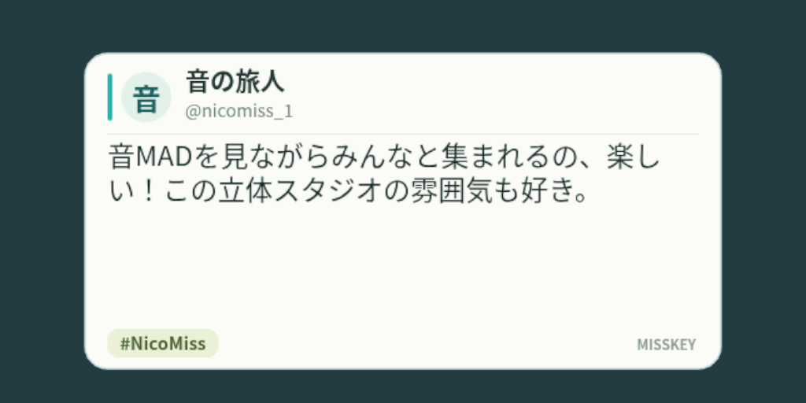
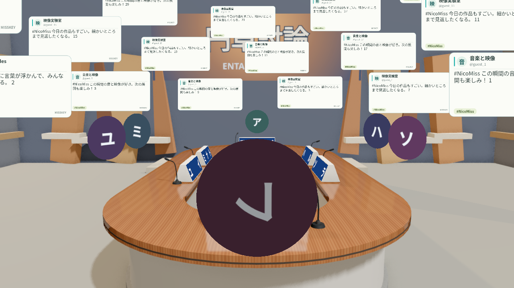

# Misskeyのハッシュタグ受信と3Dカード

ENTAKUはMisskeyの`hashtag` Streamingチャンネルから公開ノートを受信し、人物の背後に最大30枚のカードを表示する。接続先の初期値は`https://otomad.site`、タグは`NicoMiss`。受信は初期状態では無効で、Dockから有効にする。Discordに接続していないデモでも使える。

この文書は`feat/misskey-hashtag-cards`の実装を説明する。調査日は2026-11-28 JST。実装方針と代替案は[ADR 0029](adr/0029-public-hashtag-cards.md)、測定の生データは[実接続](measurements/misskey-live.json)と[描画実験](measurements/misskey-cards.json)に記録した。各記録の対象ソースと条件を確認し、別の版や実GPUの結果へ読み替えない。

## 使い始める

1. Dockの「Misskey」を開く。
2. 接続先が`https://otomad.site`、ハッシュタグが`NicoMiss`になっていることを確認する。
3. 「受信・表示を有効にする」をオンにして保存する。
4. 「受信中」になったら購読が成立している。対象の新着ノートが採用されるとOverlayにカードが現れる。

初期設定はMisskeyの公開範囲が「パブリック」のノートだけを採用する。「ホーム」も未ログインで読めることがあるが、公開タイムラインから外すための別の公開範囲なので、初期設定では表示しない。必要ならDockの「ホーム公開のノートも含める」をオンにする。フォロワー限定・ダイレクトはこの設定にかかわらず採用しない。

調査時に取得した直近5件の`#NicoMiss`ノートはすべて「ホーム」だった。したがって、購読が成功しても初期設定ではカードが出ない場合がある。表示するのは原則として直近2分以内のノートであり、過去のタグ検索結果を順に流す機能ではない。`受信中`は購読ACKを確認した状態で、投稿の発生や表示採用を意味しない。

### 表示設定

| 項目 | 初期値 | 設定できる範囲・動作 |
|---|---:|---|
| 接続先 | otomad.site | HTTPSの公開ホスト名。ポート・認証情報・パスは指定しない |
| ハッシュタグ | NicoMiss | `#`は付いていても保存時に外す。1タグを購読 |
| このインスタンスの投稿者だけ | オン | `user.host == null`で判定。オフなら接続先が認識しているリモート投稿も対象 |
| ホーム公開も含める | オフ | オンでもフォロワー限定・ダイレクトは対象外 |
| 最大表示数 | 30件 | 1〜30件。画面に多いと感じたら12〜20件などへ下げる |
| 投稿者ごとの上限 | 1件 | 1〜3件。表示中と待機中の合計に適用 |
| 表示時間 | 45秒 | 5〜120秒 |
| 本文の文字数 | 180文字 | 40〜400文字。絵文字のまとまりを分断せず省略 |
| 追加の除外語句 | 空 | 1行1語句。最大128語句、各64 UTF-16単位 |
| 除外する投稿者ID | 空 | 1行1ID。最大256件 |

表示上限は空間内で有効なカードの数である。カメラの近側にあるカードや画角外のカードは見えないため、「常に画面上で30件を読める」という意味ではない。本文は文字数制限に加えて、カード幅に収まる最大5行で省略する。省略部分をAIで要約・補完する処理はない。

設定はSQLiteへ保存し、次回起動でも使う。以前の設定データには無効の初期設定を補い、既存のスタジオ・席・プリセットの保存操作でMisskey設定が消えないようにしている。Misskeyの接続先や除外リストはnamed presetとは独立している。

### 配信中の操作

| 操作 | 結果 |
|---|---|
| 表示を一時停止 | 現在のカードと待機列を消す。接続は保ち、表示採用を止める |
| 表示を再開 | 再開時刻以降の新着から採用する。停止前に始まった補完応答から古いカードを戻さない |
| 全消去 | 現在のカードと待機列を消す。以後の新着は受信する |
| この投稿者を除外 | 表示中一覧の投稿者IDを除外リストへ保存する。設定変更に伴い現在のカードと待機列を消し、以後そのIDを採用しない |
| 受信を無効にして保存 | WebSocket・HTTP補完・表示を停止する |

除外数は公開範囲、対象外タグ、反復、重複、投稿者上限などの理由別に表示する。投稿の本文や投稿者名を通常の診断・録画・ログへ入れることはしない。ノートの本文は表示用に切り詰めた文字列として最大30件＋待機60件をメモリに保持する。

## 接続方式と制限の調査

Misskey公式のStreaming説明から、チャンネルの登録・購読・ノートcaptureを辿った。対象サーバーの`/api/meta`が示すforkを調べ、一般のMisskey最新版と対象forkの挙動を分けた。対象のメタ情報は`2026.10.0-otomad`、本文上限は3,000文字、公開リポジトリは[OtomadSite/system](https://github.com/OtomadSite/system)。照合した公開ソースは`13cde5a03c560e0bfbe9ec475157f29ae4ba1653`である。稼働サーバーの実際のcommitまで証明したものではない。

### 調べて確認したこと

| 論点 | 確認結果 | 実装への反映 |
|---|---|---|
| 専用チャンネル | `hashtag`が存在し、認証不要。外側OR・内側ANDの`q`を受け取る [S1] | LTL全体を取得せず、`q:[["NicoMiss"]]`を購読 |
| 接続成立 | `pong:true`を付けたconnectに`connected`のACKを返す [S2] | socketのopenだけで「受信中」にしない |
| 匿名の公開範囲 | `public`と`home`が候補。visitor policyやログイン必須設定で隠される場合もある [S1][S6] | 受信後にも公開範囲を検査し、homeは明示オプション |
| ローカル判定 | 接続先が連合経由で認識したノートも対象 [S1] | 投稿者の`host`で判定。ノートの`localOnly`を投稿者所属の意味には使わない |
| 検索API | `notes/search-by-tag`、1回最大100件、既定10件 [S3] | 100件ずつ、最大3要求の補完 |
| 差分取得 | `sinceId`だけなら昇順。`untilId`を併用すると並び方が変わる [S6] | `sinceId`または`sinceDate`を使う。除外したノートもcursorを進める |
| APIのレート制限 | 対象forkの検索endpointに`meta.limit`はなく、共通処理は指定があるendpointへ制限を適用 [S3][S4] | 「無制限」「毎分何回まで」とは断定しない。429とRetry-Afterを処理 |
| WSの上限 | 対象forkでは1接続32チャンネル、capture 1,536ノート [S2] | 接続1本・チャンネル1つ・capture最大90件 |
| ping/pong | 対象forkはWebSocket制御フレームで死活監視。文字列`ping`を送る方式ではない [S5] | 30秒ごとに制御ping、15秒で応答がなければ再接続 |
| 削除と編集 | captureしたノートの削除通知がある。`updated`も受け取った場合は全文の安全性を確認できない [S2][S7] | 表示・待機対象をcaptureし、deleted/updatedで即時取り下げ |
| 欠落の再送 | 切断区間のイベントを自動再生する仕組みではない [S7] | 断線時はカードを消し、接続後に範囲を限って補完 |

HTTPリバースプロキシ、CDN、サーバー運用設定による制限は公開ソースから確定できない。`rateLimitFactor=1`というメタ情報だけでは検索APIの毎分の許容量は決まらない。上限を探る負荷試験は行っていない。

### ENTAKU側で決めた通信量の上限

| 処理 | 上限・間隔 |
|---|---|
| 常時受信 | WebSocket 1本、hashtag 1チャンネル |
| 接続タイムアウト | open 15秒、購読ACK 10秒 |
| 再接続 | 1〜60秒の指数バックオフにjitterを加える |
| 補完の開始 | 初回購読・再接続のあと。定期検索はしない |
| 補完ページ | 100件×最大3要求。次ページまで最低1秒 |
| 連続再接続時の補完 | 前回HTTP要求から最低15秒あける |
| HTTP失敗の再試行 | 同じ3要求の予算内。通常15秒、30秒と待つ |
| HTTP 429 | Retry-Afterの秒数／HTTP-dateを解釈。欠落・不正なら60秒、待ち時間の上限は1時間 |
| 補完対象 | 最近2分。古いcheckpointは破棄してsinceDateへ切り替える |
| HTTP応答 | 8秒、2 MiBまで。リダイレクトは拒否 |
| WS受信メッセージ | 256 KiBを超えたメッセージは受信後に拒否。毎秒100件まで |
| live入力の審査 | burst 40件、毎秒40件を補充 |
| 表示への追加 | 最大2件/秒。最初の1件はすぐ追加 |
| ローカルUIへの通知 | 通常は最大4回/秒。取り下げ・停止などは即時通知 |

「即時」は新着イベントを受けたら定期検索を待たずに審査する、という意味である。カードの追加は視認性のため毎秒2件へ制限し、満杯なら待機列に入れる。ネットワーク・サーバー負荷を含む一定の到達時間は保証しない。メッセージのサイズ制限は受信後の検査であり、Bun内部の受信バッファやWebSocketの断片フレームのサイズを制限する設定ではない。

切断時に見えていたカードは消す。削除通知を追えない区間に残し続けないためである。過負荷でフレームを落とした場合も表示と待機列を消す。最大3要求で埋まらない欠落やHTTP失敗があれば、管理画面に「補完できていないノートがある可能性」を表示する。収集アーカイブや漏れのない監視としての動作は保証しない。

## 荒らし対策とその限界

審査は**本文を切り詰める前**に行う。末尾の除外語を省略で隠すことはできない。MFMは`mfm-js 0.28.0`で構文を読み、テキストへ変換する。アニメーション、HTML評価、外部画像、動画、カスタム絵文字画像、URLプレビューは作らない。通常の画像付き投稿は本文だけを採用できるが、CW付き・センシティブ指定のノートは除外する。

| 対策 | 実装 |
|---|---|
| 脅迫表現 | 独自の小さな初期辞書10語句＋利用者の追加語句。本文・表示名・usernameを照合 |
| 表記の揺れ | 検査用文字列をNFKC・小文字へ正規化し、句読点・空白・不可視制御文字を除く。表示する原文は別に保持 |
| 同一内容 | 正規化した全文のSHA-256で10分間重複を除外。投稿者が違っても対象 |
| 同一ノート | 採用IDと削除・編集済みIDを10分間記憶。補完による再表示を防ぐ |
| 単純な連打 | 同じgraphemeが12個以上連続する場合などを除外 |
| 短いパターンの反復 | 長さ2〜12の繰り返しを検出。24文字以上かつ概ね5回以上を基準にする |
| 一人の連投 | 表示＋待機の投稿者上限と、同じ投稿者からの採用間隔10秒 |
| 大量投稿 | live入力の審査上限、待機列60件、表示30件を固定 |
| 過大・不正入力 | 本文16,000 UTF-16単位、MFM深さ8、ノード4,096、各種フィールドの型と長さを検査 |
| 取り下げ | 削除・編集の通知で表示と待機から除去。手動の全消去・投稿者除外も用意 |

IDと内容の重複キャッシュは各2,048件、投稿者の短期キャッシュは4,096件まで。期限と件数の両方でメモリを制限する。上限を超えるほど大量の異なる投稿が来ると、古い重複記録は10分以内でも押し出される。

既成の日本語不適切語リストも調べたが、そのまま採用しなかった。一般語を含むリストや検索候補の抑制を目的とするリストは、配信用の脅迫フィルターとは目的が異なる。候補として確認した[inappropriate-words-ja](https://github.com/MosasoM/inappropriate-words-ja)はMIT、[LDNOOBW](https://github.com/LDNOOBW/List-of-Dirty-Naughty-Obscene-and-Otherwise-Bad-Words)はCC BY 4.0。配布コードにはこれらの語彙をコピーせず、用途を絞った初期辞書を持たせた。

このフィルターは意図を判断しない。引用・否定文も除外されることがあり、言い換え、画像内の文字、文脈に依存する脅迫、少しずつ変えたコピー、複数アカウントの協調投稿は検出しきれない。全文を生成AIへ送る処理もない。運用中は除外理由を確認し、必要な語句や投稿者IDを足せる。

## 3D表示と負荷

Three.jsの標準`Sprite`と`CanvasTexture`を使う。本文が変わったときに512×256のCanvasへ一度描き、浮遊とフェードは座標・スケール・透明度だけで動かす。同じノートについて毎フレームCanvasを描き直さない。外部のアバター画像は取得せず、名前の頭文字から小さなアイコンを作る。

カードはアイボリーの地に濃い文字、細いシアンの線、淡いタグ表示という構成にした。装飾を控え、投稿者名と本文を先に読めるようにする。小さなWindows風ウィンドウを重ねる方式は採らない。





上の画像の本文と投稿者名は描画試験用の合成データである。

配置は机のカプセル形状に沿う10方向×3段、合計30スロット。対向位置から埋める順序なので、少数件でも一方に偏りにくい。机の長さ・offset・stage transformへ追従し、各カメラで近側のカードを抑制する。SPLITではそれぞれの視点で判定する。人物の背後に均等な居場所を作る方式で、画面上ではカードが重なる場合もある。

`depthTest=true`、`depthWrite=false`を使い、不透明な机や壁との奥行きを保つ。カードは人物より前に描画し、3DGSのまとまった透明描画でも人物を上書きしない。表示用layerへ分け、影・反射・自動露出の対象から外す。詳細はADRに記載する。

### 測定で分かったこと

独立した合成シーンを1280×720、pixel ratio 1、SwiftShaderで測定した。20フレームのwarmup後、40フレームを計測する。通常表示とSPLITそれぞれで0枚と30枚を比較した。実GPU、OBS/CEF、ENTAKU全体のfps測定ではない。

- 30枚でカードのCanvasTextureは30個、RGBA画素分は15,728,640 bytes（15 MiB）。CPU側Canvasとドライバーの領域は含まない。
- 1,000件を入れ替えても保持テクスチャ数は30個のまま。
- 内容が変わらない計測中の追加テクスチャ更新は0回。
- dispose後のGPUテクスチャ数は0。Three.js標準Spriteの共有geometryは残るが、入れ替えで増加しない。
- 独立シーンのdraw callは通常表示で7→37、SPLITで14→74。カード1枚1drawを基本とする。

時間の生値と中央値・p95は[測定JSON](measurements/misskey-cards.json)にある。`readRenderTargetPixels`による同期とreadbackを含む時間なので、通常フレームのfpsへ単純に変換しない。30件を初期上限にする根拠は、資源が有界であることとこの比較実験であり、あらゆるPCで30件なら軽いという保証ではない。

## 実接続の確認と未確認の範囲

2026-11-28 02:36:22〜02:39:22 JSTに、対象インスタンスへ180秒間の読み取り専用接続を行った。6.838秒でhashtag購読ACKを確認し、その後約173秒間、切断・再接続なしで維持した。REST補完の1件は`not-public`で除外された。`lastEventAt`はnullで、**この時間帯に新着ノートのstreamイベントは観測していない**。

したがって、実サーバーで確認できたのは匿名購読、接続維持、補完APIの応答までである。投稿からカード表示までの実測遅延、実際の削除・編集イベント、イベント開催時の高負荷は未測定。実験中の投稿や外部へのメッセージ送信は行っていない。

開始時のソースhashは[実接続JSON](measurements/misskey-live.json)にある。その後、型不正な安全フラグ・usernameの除外判定と、反復過負荷時の取り下げを修正した。これらの経路は合成テストで確認し、180秒の実接続を繰り返してはいない。

単体・結合試験では公開範囲、重複、反復、上限、期限、pause/resume、429、heartbeat、再接続、古い応答の拒否、補完cursor、削除・編集、反復過負荷を検査する。Playwrightでは実Overlayの30枚表示、上限、SPLIT、文字列の無害な表示、設定保存、投稿者除外、pause/clear/切断を確認する。実GPU、WindowsのOBS/CEF、長時間の実配信は別途確認が必要。

## 再実行

```sh
bun install --frozen-lockfile
bun run typecheck
bun test tests/unit/misskey-*.test.ts tests/integration/misskey-api.test.ts
bun run build:web
bunx playwright test e2e/misskey.spec.ts

# 外部へ接続する読み取り専用実験。本文や投稿者情報は記録しない。
bun run probe:misskey --seconds 180 --output docs/measurements/misskey-live.json

# 独立した合成描画実験
bun run bench:misskey --software --frames 40
```

実接続でホーム公開も審査する場合は`--include-home`を加える。描画実験を実GPUで行う場合は`--software`を外す。ソフトウェアrendererが検出された場合は、実GPUの測定として保存しない。Chromeの場所を指定する必要がある環境では、E2Eに`ENTAKU_CHROMIUM_PATH`、独立描画実験に`PLAYWRIGHT_CHROMIUM_EXECUTABLE`を使う。

この作業環境ではAF_UNIXを作成できず、既存のIPC模擬試験12件がソケット作成時点で失敗する。Misskeyのためのskipやテスト条件の緩和は入れていない。リポジトリ全体の最終判定は対象HEADのLinux／Windows／ブラウザCIで確認する。

## 一次資料

以下のforkのリンクは調査したcommitへ固定している。

- [S1: hashtagチャンネル](https://github.com/OtomadSite/system/blob/13cde5a03c560e0bfbe9ec475157f29ae4ba1653/packages/backend/src/server/api/stream/channels/hashtag.ts)
- [S2: Streaming Connectionとcapture上限](https://github.com/OtomadSite/system/blob/13cde5a03c560e0bfbe9ec475157f29ae4ba1653/packages/backend/src/server/api/stream/Connection.ts)
- [S3: notes/search-by-tag](https://github.com/OtomadSite/system/blob/13cde5a03c560e0bfbe9ec475157f29ae4ba1653/packages/backend/src/server/api/endpoints/notes/search-by-tag.ts)
- [S4: API共通処理](https://github.com/OtomadSite/system/blob/13cde5a03c560e0bfbe9ec475157f29ae4ba1653/packages/backend/src/server/api/ApiCallService.ts)
- [S5: StreamingApiServerService](https://github.com/OtomadSite/system/blob/13cde5a03c560e0bfbe9ec475157f29ae4ba1653/packages/backend/src/server/api/StreamingApiServerService.ts)
- [S6: QueryServiceとvisibility・pagination](https://github.com/OtomadSite/system/blob/13cde5a03c560e0bfbe9ec475157f29ae4ba1653/packages/backend/src/core/QueryService.ts)
- [S7: Misskey公式Streaming API](https://misskey-hub.net/ja/docs/for-developers/api/streaming/)、[ノートcaptureイベント](https://misskey-hub.net/ja/docs/for-developers/api/streaming/note-capture-events/)
- [Three.js Sprite](https://threejs.org/docs/pages/Sprite.html)、[CanvasTexture](https://threejs.org/docs/pages/CanvasTexture.html)、[CSS2DRenderer](https://threejs.org/docs/pages/CSS2DRenderer.html)
- [mfm-js](https://github.com/misskey-dev/mfm.js)。ライセンスと同梱依存の表記は[THIRD_PARTY_NOTICES](../THIRD_PARTY_NOTICES.md)を参照。
